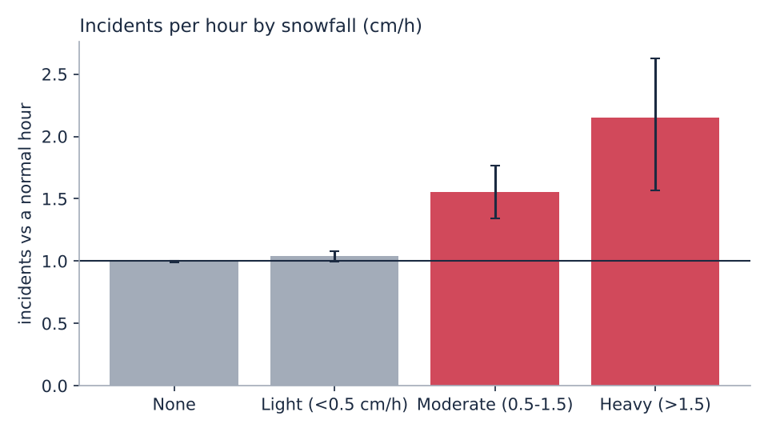
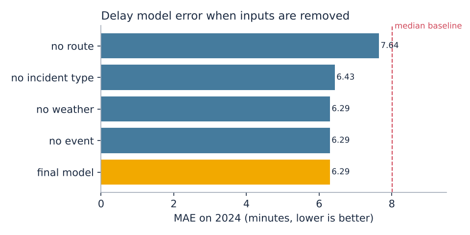
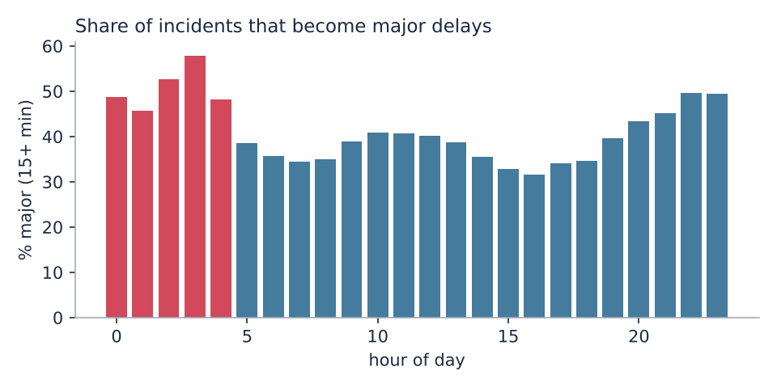

# Case study: what makes Toronto's buses late?

## Why I did this

Everyone blames the snow, the Jays crowds or rush hour when the bus is late. I wanted to check that against real data, and build something that estimates how long a delay will last as soon as an incident is reported.

## Data

The City of Toronto publishes every TTC bus delay incident. There were 115,850 in 2023 and 2024, each with a time, route, location, incident type and how late it made the next bus. I joined them with hourly weather for downtown Toronto (Open-Meteo), the start times of all 162 Blue Jays home games (MLB Stats API) and Ontario holidays.

After removing rows with no readable time, duplicate reports and delays over 2 hours (mostly long diversions and typos), 111,750 incidents (96.5%) were left.

The biggest thing I had to figure out early was what a row actually is. It's an incident, not a trip, so on-time buses never show up. That meant I couldn't answer "will my bus be late?". I split it into two questions instead:

1. Given an incident, how late will the next bus be, and will it be a major (15+ minute) delay?
2. Do weather or events change how many incidents happen? For this I made a table of all 17,544 hours in the two years, including quiet ones.

## Approach

- I trained on January to September 2023, chose the model on October to December 2023, and tested once on all of 2024, so the model never sees the future.
- Every model had to beat simple baselines: the median delay, and the median for each incident type.
- For weather I compared, for example, a snowy 8 am Monday with a normal 8 am Monday (same year, weekday and hour), not with the yearly average.
- I retrained the final models without weather, events, route and incident type to see how much each one helps.

## Results (2024)

- The delay model (gradient boosting) is off by 6.3 minutes on average, 21% better than guessing the median (8.0 minutes).
- The major-delay model gets ROC-AUC 0.84 and F1 0.70, against 0.56 and 0.24 for the incident-type rule.
- Heavy snowfall (over 1.5 cm an hour) came with 2.2x the usual number of incidents. Moderate rain was about 1.2x.
- Blue Jays games made no measurable difference. Holidays had about 40% fewer incidents.

## What surprised me

Weather doesn't make delays longer. Taking every weather input out of the delay model left its error at 6.29 minutes. Snow causes more incidents, but each one takes about as long to clear.

The route is the most useful input. Without it the error goes up to 7.6 minutes. Routes that run less often leave a longer gap when a bus drops out.

Nights are worse than rush hour. Rush hour has the most incidents, but 50% of night incidents (midnight to 5 am) become major delays, against 32% at rush hour.

## Limitations and next steps

- The model only explains part of the variation (R² 0.28). Things like spare bus availability and live traffic aren't in the data.
- Events only cover baseball. Adding concerts and other sports would need a reliable historical source.
- The 2025 TTC data uses incident codes instead of categories. Mapping them would give a third year to test on.
- Next I'd like to predict incident counts per route and hour from the weather forecast, which could help plan spare buses on snowy days.

## Tools

Python, pandas, scikit-learn, Plotly, Streamlit, pytest, GitHub Actions and Docker. The app is live at [late-again.streamlit.app](https://late-again.streamlit.app).
