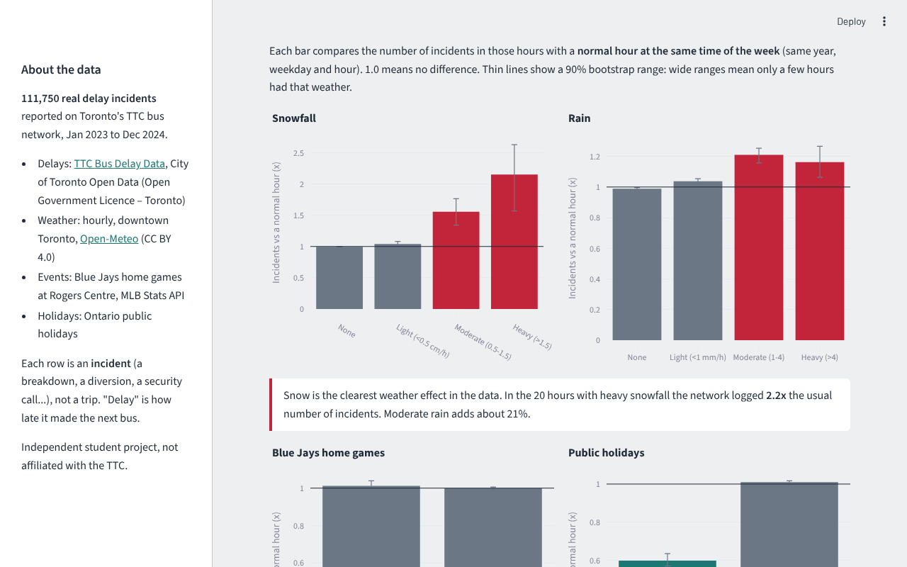
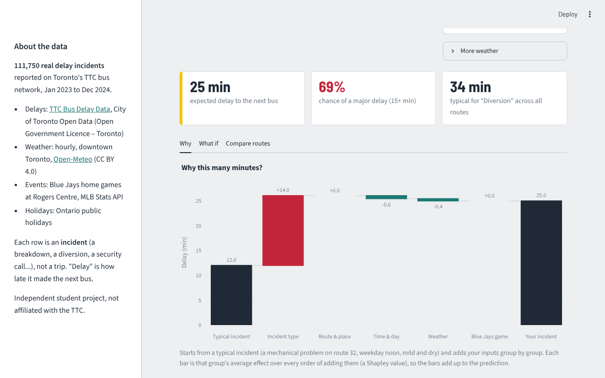

# Late Again 🚌
### Public Transport Delays with Weather & Events

[](https://github.com/TrulyAchyuth/Late-Again/actions/workflows/ci.yml)
**Live app: [late-again.streamlit.app](https://late-again.streamlit.app)**

An end-to-end machine learning project on **real Toronto bus delay data**. It joins 111,750 TTC delay incidents (2023–2024) with hourly weather, baseball games and public holidays, asks what really makes delays worse, and predicts how late the next bus will be when an incident is reported.


## Results at a glance

All numbers are measured on **2024**, a full year the models never saw during training (`reports/metrics.json`).

| | Result | Simple baseline |
|---|---|---|
| **Delay length** (Gradient Boosting) | **6.3 min** average error, **21% lower** than the baseline | 8.0 min (always guess the median) |
| **Major delay, 15+ min** (Gradient Boosting) | **ROC-AUC 0.84**, F1 0.70 | ROC-AUC 0.56, F1 0.24 (rule of thumb by incident type) |
| **Heavy snow** (analysis) | **2.2x** the usual number of incidents per hour | 1.0x = a normal hour at the same time of week |

Three findings from the data:
1. **The route matters most.** Removing the route from the model raises its error from 6.3 to 7.6 minutes. Routes that run less often leave longer gaps when something goes wrong.
2. **Weather changes how many incidents happen, not how long they last.** Heavy snowfall more than doubled incidents per hour, but retraining the delay model without any weather inputs did not change its error.
3. **Late nights are the worst.** 50% of incidents between midnight and 5 am become major delays, against 32% in weekday rush hours.

---

## 1. Data

| Source | What it gives | Licence |
|---|---|---|
| [TTC Bus Delay Data](https://open.toronto.ca/dataset/ttc-bus-delay-data/), City of Toronto Open Data | One row per delay incident: date, time, route, location, incident type, delay and gap in minutes, direction, vehicle | Open Government Licence – Toronto |
| [Open-Meteo historical weather API](https://open-meteo.com/en/docs/historical-weather-api) | Hourly temperature, precipitation, rain, snowfall, snow depth, wind and gusts, weather code for downtown Toronto | CC BY 4.0 |
| [MLB Stats API](https://statsapi.mlb.com) | Start times of the 162 Toronto Blue Jays home games at Rogers Centre in 2023–24 | Free public API (used for non-commercial research) |
| [`holidays`](https://pypi.org/project/holidays/) Python package | Ontario public holidays | MIT |

**Important: what a row means.** The TTC publishes *incidents*, not every trip. Buses that ran on time are not in the data. So the models answer *"an incident has just been reported; how late will the next bus be?"*, not *"will my bus be late?"*. Weather and event effects are measured on a complete table of every hour in 2023–24 (17,544 hours, including quiet hours with zero incidents).

### Field guide (processed incident table, `data/processed/incidents.csv.gz`)

| Field | Meaning |
|---|---|
| `timestamp` | When the incident happened (local Toronto time) |
| `route`, `direction` | Bus route number; direction N/S/E/W/B (both), or Unknown when not recorded |
| `location`, `at_station` | Where it happened; 1 if at a station |
| `incident` | TTC's incident category, e.g. Mechanical, Diversion, Security |
| `delay_min` | **Target.** Minutes the next bus was delayed |
| `gap_min` | Minutes between buses after the incident (an *outcome*, so never used as a model input) |
| `major_delay` | **Target.** 1 if `delay_min` ≥ 15 |
| `hour`, `month`, `day_of_week`, `is_weekend`, `is_holiday`, `is_rush_hour` | Calendar features (rush hour = hours starting 7, 8 or 9 am and 4, 5 or 6 pm on working days) |
| `temperature_c`, `precipitation_mm`, `rain_mm`, `snowfall_cm`, `snow_depth_cm`, `wind_kmh`, `gust_kmh`, `weather` | Weather in that hour |
| `jays_game_window` | 1 if between 1 hour before and 4 hours after the start of a Blue Jays home game |

### Cleaning (`src/build_dataset.py`)
From 115,850 raw incidents: 1,192 rows with no readable time, incident or route were dropped; 557 exact duplicate reports were dropped; 2,351 delays over 120 minutes (mostly long diversions and typing errors, about 2%) were removed as outliers. **111,750 incidents (96.5%) were kept**, and every one matched a weather hour.

## 2. Method

- **Time-based split, no shuffling.** Train on Jan–Sep 2023, pick the best model on Oct–Dec 2023, refit on all of 2023, then test **once** on all of 2024. A random split would let the model peek at the future.
- **Models compared:** Logistic/Linear Regression, Decision Tree, Random Forest, Gradient Boosting (scikit-learn `HistGradientBoosting`). The delay model minimises absolute error because delays are heavily skewed.
- **Baselines:** always guess the median delay; the median for that incident type; always predict "not major".
- **Ablation:** the winning models are retrained without the weather inputs, the event inputs, the route and the incident type, to measure what each really adds.
- **Weather/event analysis:** each group of hours is compared with a normal hour at the same year, weekday and hour, with a 90% bootstrap range (`src/analysis.py`).

Validation scores for every model (Oct–Dec 2023):

| Model | Major delay ROC-AUC | Major delay F1 | Delay MAE (min) |
|---|---|---|---|
| Logistic / Linear Regression | 0.841 | 0.711 | 6.15 |
| Decision Tree | 0.655 | 0.490 | 7.06 |
| Random Forest | 0.813 | 0.538 | 6.70 |
| **Gradient Boosting** | **0.866** | **0.718** | **5.58** |

Ablation on 2024 (lower MAE / higher ROC-AUC is better):

| Retrained without | ROC-AUC | MAE (min) |
|---|---|---|
| nothing (final model) | 0.839 | 6.29 |
| weather inputs | 0.842 | 6.29 |
| event inputs | 0.839 | 6.29 |
| incident type | 0.826 | 6.43 |
| route | 0.602 | 7.64 |

## 3. The dashboard

`streamlit run app.py` opens six tabs: **Overview**, **When it happens** (weekday × hour heatmaps), **Routes & causes**, **Weather & events** (snow, rain, games, holidays vs a normal hour), **How good is the model** (test scores, baselines, actual vs predicted, feature importance, ablation) and **Predict an incident**. The prediction tab can pull real Toronto weather for any date from Open-Meteo, explains each prediction with Shapley values over five input groups, and shows what-if and route comparisons.

| Overview | Weather & events | Prediction |
|---|---|---|
|  |  |  |

## 4. Run it

Python 3.13 is recommended (the versions in `requirements.txt` are pinned and tested with it).

```bash
git clone https://github.com/TrulyAchyuth/Late-Again.git
cd Late-Again
python -m venv .venv && source .venv/bin/activate      # Windows: .venv\Scripts\activate
pip install -r requirements.txt
streamlit run app.py                                   # opens http://localhost:8501
```

The processed data and trained models are in the repo, so the app starts straight away. To rebuild everything from the original sources:

```bash
python run_pipeline.py             # download (about 8 MB) -> clean -> train   (about 2 minutes)
python run_pipeline.py --offline   # retrain from the processed data already in the repo
```

**Docker:**
```bash
docker build -t late-again .
docker run -p 8501:8501 late-again
```

**Tests and notebook:**
```bash
pip install -r requirements-dev.txt
python -m pytest                       # 14 tests: features, cleaning, analysis, models, app start-up
jupyter notebook notebooks/eda.ipynb   # step-by-step EDA (saved with outputs)
```

GitHub Actions runs the tests on every push, retrains the models from the committed data and fails if the scores drop below the baseline.

## 5. Project structure

```
app.py                    Streamlit dashboard
assets/style.css          dashboard styles
run_pipeline.py           runs download -> build -> train
src/
  config.py               paths, data sources, settings, feature lists
  download_data.py        downloads TTC, Open-Meteo and MLB data
  features.py             small feature helpers (unit-tested)
  build_dataset.py        cleaning and joining -> data/processed/
  analysis.py             "compared with a normal hour" weather/event analysis
  train.py                time-based split, baselines, models, ablation
  predict_tools.py        prediction, Shapley explanation, what-if
  live_weather.py         live Toronto weather for the prediction form
  plots.py                Plotly charts and colours
notebooks/eda.ipynb       exploratory analysis
tests/                    pytest unit and smoke tests
docs/                     screenshots, demo GIF
CASE_STUDY.md             short write-up of the project
Dockerfile, .github/workflows/ci.yml
```

## 6. Limitations

- **Incidents, not trips.** On-time buses are not recorded, so the models cannot say how likely *a given trip* is to be late.
- **Weather is for downtown Toronto only**, hourly. Local conditions across the city can differ.
- **Events are only Blue Jays home games.** No free, clean source was found for concerts, Raptors/Leafs games or festivals over 2023–24.
- **Route and incident type dominate.** The model explains about 28% of the variation in delay length (R² 0.28 on 2024); a lot depends on things not in the data, such as how quickly a replacement bus is found.
- **Data quality.** Delays are typed by hand and often rounded (10, 20, 30 min); delays over 120 minutes were removed.
- The data ends in December 2024. TTC changed its file format in 2025 (incident codes instead of categories), so newer data would need its own mapping.

*Independent student project. Not affiliated with or endorsed by the TTC or the City of Toronto.*
