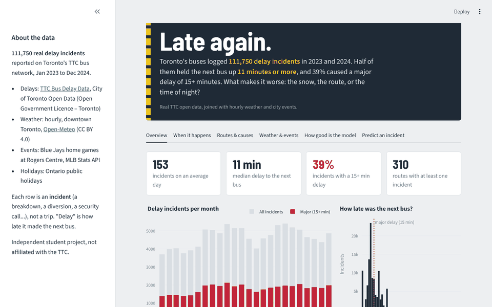
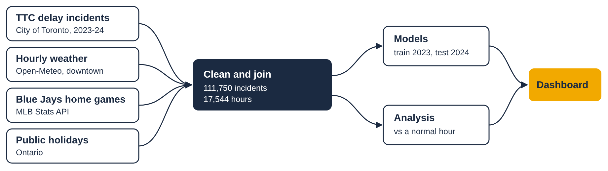

<p align="center"></p>

<p align="center">
Public transport delays in Toronto, with weather and events.<br>
<a href="https://late-again.streamlit.app">Live app</a> |
<a href="CASE_STUDY.md">Case study</a> |
<a href="notebooks/eda.ipynb">Notebook</a>
</p>

[](https://github.com/TrulyAchyuth/Late-Again/actions/workflows/ci.yml)

I take the bus a lot and wanted to know whether snow, games or the time of day actually make delays worse. This project uses the City of Toronto's open data on TTC bus delays (111,750 incidents in 2023 and 2024), adds hourly weather, Blue Jays home games and public holidays, and trains models that estimate how long a delay will be once an incident is reported.



## Results

Everything below is measured on 2024, a year the models never saw while training.

| | Result | Baseline |
|---|---|---|
| Delay length | 6.3 min average error (21% lower) | 8.0 min, always guessing the median |
| Major delay (15+ min) | ROC-AUC 0.84, F1 0.70 | ROC-AUC 0.56, F1 0.24, rule based on incident type |
| Heavy snow | 2.2x the usual incidents per hour | 1.0x, a normal hour at the same time of week |

What I found:
- The route matters most. Without it the delay error goes from 6.3 to 7.6 minutes.
- Weather changes how many incidents happen, but not how long they last. Removing all weather inputs left the error the same.
- Nights are worse than rush hour: 50% of incidents between midnight and 5 am become major delays, compared with 32% at rush hour.

## Dashboard

The app has seven pages: Overview, Timing, Routes, Weather, Model, Predict and About. On Predict you describe an incident, optionally pull the real Toronto weather for that hour, and see the expected delay, why the model thinks so, and how it changes with the hour, incident type or route.

| Overview | Weather | Predict |
|---|---|---|
|  |  |  |

## Data



| Source | What I used | Licence |
|---|---|---|
| [TTC Bus Delay Data](https://open.toronto.ca/dataset/ttc-bus-delay-data/) (City of Toronto) | one row per incident: date, time, route, location, incident type, delay, gap, direction | Open Government Licence, Toronto |
| [Open-Meteo](https://open-meteo.com/en/docs/historical-weather-api) | hourly weather for downtown Toronto | CC BY 4.0 |
| [MLB Stats API](https://statsapi.mlb.com) | start times of the 162 Blue Jays home games | free public API, non-commercial use |
| [`holidays`](https://pypi.org/project/holidays/) | Ontario public holidays | MIT |

One thing to know: the TTC data lists incidents, not trips. Buses that were on time aren't in it. So the model answers "an incident was just reported, how late will the next bus be?", not "will my bus be late?". For weather and events I built a second table with every hour of 2023 and 2024 (17,544 hours, including hours with no incidents).

Cleaning (`src/build_dataset.py`): out of 115,850 raw rows I dropped 1,192 with no readable time, incident or route, 557 duplicates, and 2,351 delays over 120 minutes (mostly long diversions and typos). That leaves 111,750 incidents (96.5%), all matched to a weather hour.

<details>
<summary>Column guide for <code>data/processed/incidents.csv.gz</code></summary>

| Column | Meaning |
|---|---|
| `timestamp` | when the incident happened (Toronto time) |
| `route`, `direction` | route number; N/S/E/W/B, or Unknown |
| `location`, `at_station` | where it happened; 1 if at a station |
| `incident` | TTC incident category, e.g. Mechanical, Diversion, Security |
| `delay_min` | target: minutes the next bus was delayed |
| `gap_min` | minutes between buses afterwards (an outcome, so not used as an input) |
| `major_delay` | target: 1 if `delay_min` is 15 or more |
| `hour`, `month`, `day_of_week`, `is_weekend`, `is_holiday`, `is_rush_hour` | calendar features (rush hour = 7-10 am and 4-7 pm on working days) |
| `temperature_c`, `precipitation_mm`, `rain_mm`, `snowfall_cm`, `snow_depth_cm`, `wind_kmh`, `gust_kmh`, `weather` | weather in that hour |
| `jays_game_window` | 1 from an hour before to 4 hours after a Blue Jays home game starts |
</details>

## Method

- Time-based split with no shuffling: train on Jan to Sep 2023, pick the model on Oct to Dec 2023, refit on all of 2023 and test once on 2024.
- Models: logistic/linear regression, decision tree, random forest and gradient boosting (`HistGradientBoosting`). The delay model uses absolute error because delays are very skewed.
- Baselines: the median delay, the median for each incident type, and always predicting "not major".
- Ablation: retrain the final models without weather, events, route or incident type to see what each adds.
- Weather and events: compare each group of hours with a normal hour at the same year, weekday and hour, with a 90% bootstrap range.

Validation (Oct to Dec 2023):

| Model | ROC-AUC | F1 | MAE (min) |
|---|---|---|---|
| Logistic / Linear Regression | 0.841 | 0.711 | 6.15 |
| Decision Tree | 0.655 | 0.490 | 7.06 |
| Random Forest | 0.813 | 0.538 | 6.70 |
| Gradient Boosting | 0.866 | 0.718 | 5.58 |

Ablation (2024 test):

| Removed | ROC-AUC | MAE (min) |
|---|---|---|
| nothing | 0.839 | 6.29 |
| weather | 0.842 | 6.29 |
| events | 0.839 | 6.29 |
| incident type | 0.826 | 6.43 |
| route | 0.602 | 7.64 |

## Running it

Tested with Python 3.13.

```bash
git clone https://github.com/TrulyAchyuth/Late-Again.git
cd Late-Again
python -m venv .venv && source .venv/bin/activate   # Windows: .venv\Scripts\activate
pip install -r requirements.txt
streamlit run app.py
```

The cleaned data and trained models are in the repo, so the app works straight away. To rebuild from the original sources:

```bash
python run_pipeline.py             # download (about 8 MB), clean, train: about 2 minutes
python run_pipeline.py --offline   # only retrain, using data/processed/
```

With Docker:

```bash
docker build -t late-again .
docker run -p 8501:8501 late-again
```

Tests and notebook:

```bash
pip install -r requirements-dev.txt
python -m pytest
jupyter notebook notebooks/eda.ipynb
```

GitHub Actions runs the tests on every push, retrains the models and fails if they stop beating the baseline.

## Project layout

```
app.py                  Streamlit dashboard
run_pipeline.py         download -> build -> train
src/
  config.py             paths, sources, settings
  download_data.py      gets the TTC, Open-Meteo and MLB data
  features.py           feature helpers
  build_dataset.py      cleaning and joining
  analysis.py           weather and event comparisons
  train.py              split, baselines, models, ablation
  predict_tools.py      prediction, explanation, what-if
  live_weather.py       weather lookup for the Predict page
  plots.py              Plotly charts
  make_figures.py       static charts for the docs
assets/                 logo and diagram
notebooks/eda.ipynb     exploratory analysis
tests/                  pytest tests
docs/                   screenshots, GIF, figures
```

## Limitations

- On-time buses aren't recorded, so I can't predict whether a particular trip will be late.
- Weather comes from one point downtown.
- Events are only Blue Jays home games. I couldn't find a clean free source for concerts or other sports for 2023-24.
- The delay model explains about 28% of the variation (R² 0.28). A lot depends on things not in the data, like how fast a spare bus is found.
- Delays are typed in by hand and often rounded to 10, 20 or 30 minutes.
- The data stops at the end of 2024. The 2025 files use incident codes instead of categories, so they'd need a mapping first.

Student project, not affiliated with the TTC or the City of Toronto.
